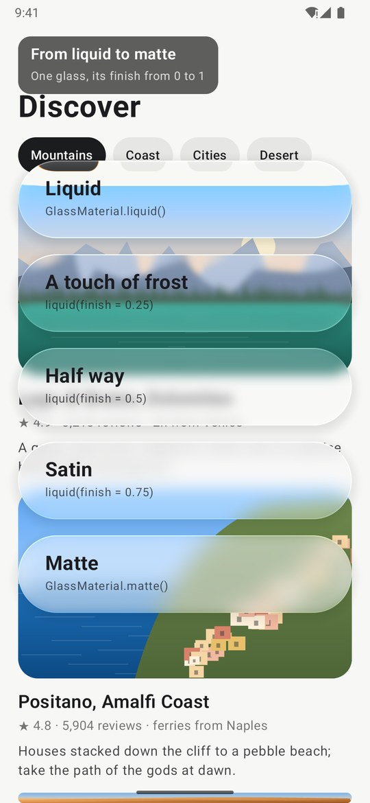
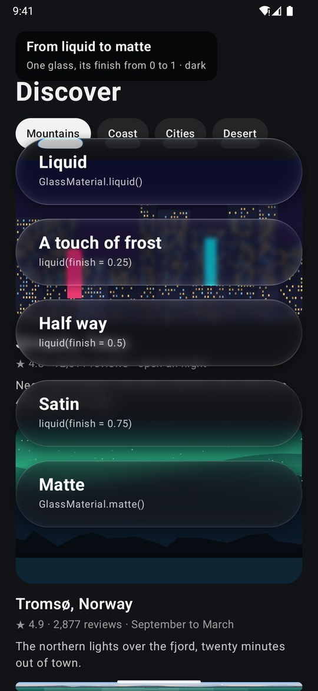
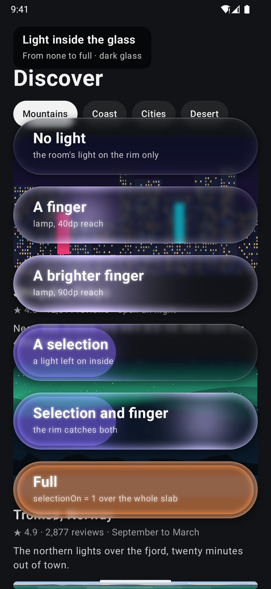
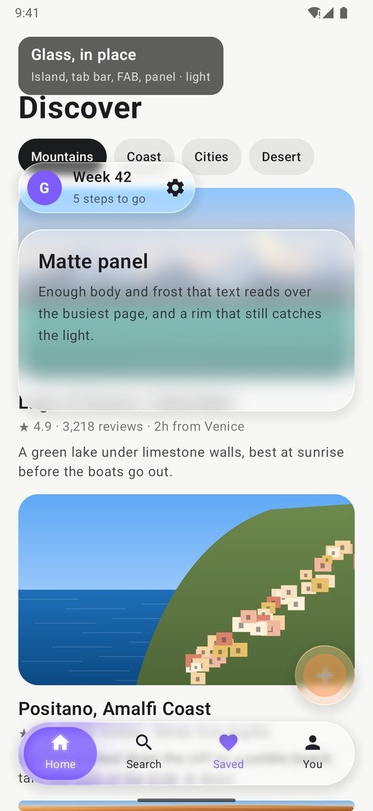
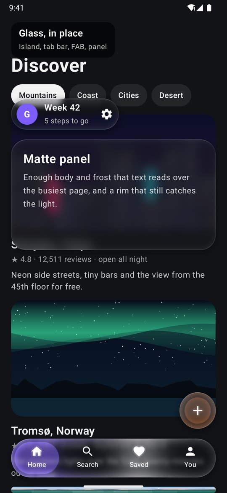
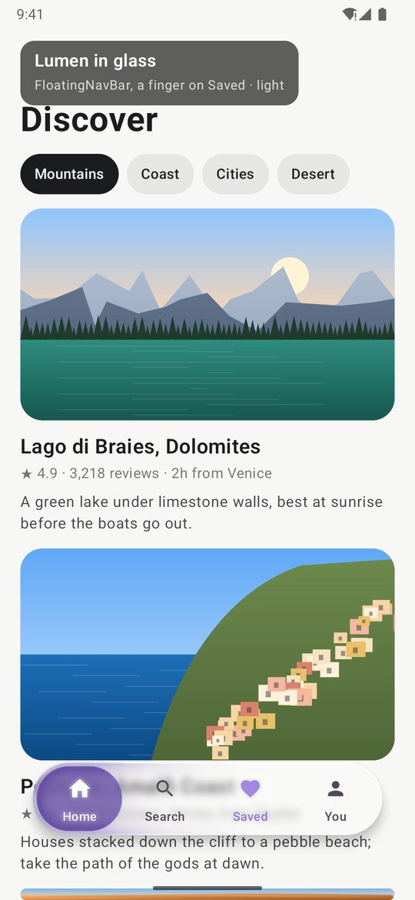
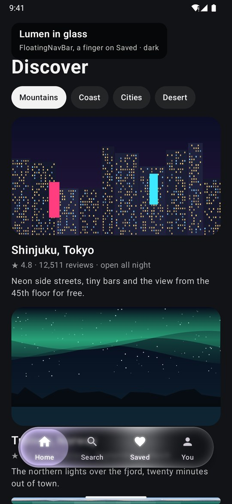

# Glass

**A glass material for Jetpack Compose, with light that lives inside it.**

Liquid glass, drawn with two AGSL programs, from all but clear to matte along one finish:

- **The page bends at the rim.** What is under the glass is refracted where the rim falls away, so
  the edge magnifies, with a touch of chromatic dispersion; through the glass it is a little richer in
  colour, never washed out to grey.
- **The edge catches the light.** A fine line of light runs round it, glinting where the room's light
  meets it and on the far side, with a faint glow just inside it and a soft shadow under the glass. No
  bevel, no side in shade. The glints can follow the phone turning (`rememberTiltKeyLight`), if you ask.
- **Content is engraved.** Icons and labels sit *inside* the slab: they bend at the rim too, a little
  less, and the polished rim can mirror them.
- **Light lives inside.** The finger is a lamp put down on the glass — its light spreads through the body
  and runs out to the rim. A selection is a light left on inside, the shape of its plate, which the rim
  catches as it passes. Engraved marks light up as the light reaches them.

| From liquid to matte | The same, dark | Light inside the glass |
|:---:|:---:|:---:|
|  |  |  |

| Glass in place | Glass in place, dark |
|:---:|:---:|
|  |  |

| compose-lumen's bar in glass | The same, dark |
|:---:|:---:|
|  |  |

<sub>Captured on an Android 15 emulator from `demo/`'s `GalleryActivity` (`--ei shot 0…6`). The app under the
glass is an ordinary travel feed whose photos are painted in code.</sub>

Full glass needs Android 13 (API 33, AGSL). Below that — and on phones that would struggle with it — a
surface is drawn at a lower [quality](#quality-and-older-devices): frosted (API 31+) or tinted (any API),
still liquid glass to look at, with its line of light, its shadow and its lights. It never crashes, and
`glassShaderError()` tells you why the programs are not used.

## Install

Published on [JitPack](https://jitpack.io/#angelomarzocchi/compose-glass).

```kotlin
// settings.gradle.kts
dependencyResolutionManagement {
    repositories {
        google()
        mavenCentral()
        maven("https://jitpack.io")
    }
}

// build.gradle.kts
dependencies {
    implementation("com.github.angelomarzocchi:compose-glass:1.1.1")
}
```

minSdk 24, compileSdk 37, Compose BOM `2026.09.00` or later. No Material dependency.

## Quick start

Glass needs to *see* the page under it. Record the page into a backdrop, and put the glass **next to**
the page, over it — never inside it (it would be looking at itself).

```kotlin
val backdrop = rememberGlassBackdrop()
val dark = isSystemInDarkTheme()

Box(Modifier.fillMaxSize()) {
    // The page: recorded every frame for the glass to see.
    LazyColumn(Modifier.fillMaxSize().glassBackdrop(backdrop)) { /* … */ }

    // The glass, over the page, as a sibling.
    val lamp = rememberGlassLamp()
    GlassSurface(
        backdrop = backdrop,
        material = GlassMaterial.liquid(dark, finish = 0.3f),
        modifier = Modifier
            .align(Alignment.BottomCenter)
            .padding(16.dp)
            .size(280.dp, 64.dp)
            .glassLampFollowsFinger(lamp),   // the finger carries a light; clicks still pass through
        lamp = lamp,
        dark = dark,
    ) {
        Text("Engraved in glass", Modifier.align(Alignment.Center))
    }
}
```

### Materials

| | |
|---|---|
| `GlassMaterial.liquid(dark, finish)` | **The default.** Liquid glass: the page bends across a wide, soft rim and shows through richer in colour; a fine line of light round the edge, a soft shadow under it. `finish` runs from 0, the clear lens, to 1, matte. About 0.3 suits a bar over a busy page. |
| `GlassMaterial.matte(dark)` | `liquid` at finish 1: frosted, full-bodied, for a panel or a sheet that holds a lot to read. |
| `lerp(a, b, fraction)` | Any glass in between two: a bar that frosts as the page scrolls under it, a bubble turning into a sheet. |

The acrylic look of earlier versions is still there, for whoever wants a slab with a bevel: a darker,
denser rim, lit on one side and in shade on the other.

| | |
|---|---|
| `GlassMaterial.clear(dark)` | Lit acrylic: a thin rim that bends the page only in its last few dp, depth shown by thickness and light. |
| `GlassMaterial.lens(dark)` | A wide rim that bends the page across all of it, splits the colours and mirrors the labels. Loud. |
| `GlassMaterial.frosted(dark)` | Clear acrylic, frosted and denser. |

Every property is a field of the `GlassMaterial` data class — `copy()` it: rim width (`bevel`),
`refraction`, `falloff`, `dispersion`, `frost`, `tint`/`tintAmount`, `edge`, `rim`, `specular`,
`inkDepth`, `inkReflection`, `inkGlow`, `lampReach`, the fine line of light along the edge (`hairline`,
as bright as the `rim` unless set, `farHairline` for the far side, `hairlineWidth`, and `hairlineFocus`,
how much it gathers into glints), `saturation` (the page's colour through the glass), `rimGlow` (an even
light just inside the edge) and `shadow`. `edge`, `rim` and `specular` are the acrylic slab's shading:
liquid glass keeps them at 0.

### Lights

`GlassSurface`'s `lighting` block runs every frame, in the surface's own pixels, from the draw phase:
read animated values there, not in composition.

```kotlin
val roomLight = rememberTiltKeyLight()          // optional: the glints follow the phone turning
val at = remember { Animatable(0f) }            // where the selection is, in tabs

GlassSurface(
    backdrop, material,
    lighting = { size ->
        keyLight = roomLight()
        val cell = size.width / tabCount
        selection = Rect(at.value * cell + 6f, 6f, (at.value + 1) * cell - 6f, size.height - 6f)
        selectionOn = 1f
        selectionColor = accent
        selectionInk = Color.White              // engraved icons turn white in the selection's light
    },
) { /* tabs */ }
```

A light that fills up is just `selectionOn` animated from 0 to 1 — the demo's "hold to fill" button.

### Your own shapes

`GlassSurface` is a rounded rectangle or a capsule. For a surface that draws its own shape — one whose
ends move — use the painter directly:

```kotlin
val painter = rememberGlassPainter()
Box(
    Modifier
        .glassPosition(painter)
        .drawBehind {
            painter.light { lamp = …; lampOn = … }
            with(painter) { drawBody(backdrop, material, shape = myRect, radius = r, dark = dark) }
        }
        .graphicsLayer {
            painter.light { /* the same lights */ }
            renderEffect = painter.inkEffect(this, material, myRect, r)   // engraving; null below full quality
            compositingStrategy = if (painter.engravingIsolated()) CompositingStrategy.Offscreen else CompositingStrategy.Auto
        }
        .drawWithContent {
            painter.light { /* the same lights */ }
            with(painter) { drawEngraving(material) }   // the marks, coloured in the lights where there is no effect
        },
) { /* content */ }
```

### A navigation bar in glass

[compose-lumen](https://github.com/angelomarzocchi/compose-lumen)'s `FloatingNavBar` takes an
`IslandMaterial`. This adapter puts it in glass — the selected tab becomes a light inside (compose-lumen
1.3.0 or later; on 1.2 leave out `drawMarks` and `isolatesContent`):

```kotlin
class GlassIsland(
    private val backdrop: GlassBackdrop,
    private val material: GlassMaterial,
    private val painter: GlassPainter,
    private val keyLight: () -> Offset = { DefaultKeyLight },
) : IslandMaterial {
    override val modifier: Modifier = Modifier.glassPosition(painter)

    private fun GlassLighting.from(lights: IslandLights) {
        lamp = lights.lamp
        lampOn = lights.lampOn
        lampInk = if (lights.dark) Color.White else lights.accent
        selection = lights.selection
        selectionOn = 1f
        selectionColor = lights.accent
        selectionInk = Color.White
        keyLight = this@GlassIsland.keyLight()
    }

    override fun DrawScope.drawIsland(shape: Rect, radius: Float, overhang: Float, lights: IslandLights) {
        painter.light { from(lights) }
        with(painter) { drawBody(backdrop, material, shape, radius, lights.dark, overhang) }
    }

    override fun contentEffect(density: Density, shape: Rect, radius: Float, lights: IslandLights): RenderEffect? {
        painter.light { from(lights) }
        return painter.inkEffect(density, material, shape, radius)
    }

    // Below full quality there is no engraving effect: the marks take the lights' colours here instead.
    override fun ContentDrawScope.drawMarks(shape: Rect, radius: Float, lights: IslandLights) {
        painter.light { from(lights) }
        with(painter) { drawEngraving(material) }
    }

    override fun isolatesContent(lights: IslandLights): Boolean {
        painter.light { from(lights) }
        return painter.engravingIsolated()
    }
}

@Composable
fun rememberGlassIsland(backdrop: GlassBackdrop, material: GlassMaterial, keyLight: () -> Offset = { DefaultKeyLight }): GlassIsland {
    val painter = rememberGlassPainter()
    return remember(backdrop, material, painter, keyLight) { GlassIsland(backdrop, material, painter, keyLight) }
}

// FloatingNavBar(items, selected, onSelect, material = rememberGlassIsland(backdrop, GlassMaterial.liquid(dark, finish = 0.3f)))
```

## Performance

A surface is two layers and a third for what it holds: the page under it, frosted; the body's program
over that; the engraving's program over its content. Each is drawn again only when what it depends on
changes. The page under the glass changes whenever the page does, and takes the frost and the body with
it; a light that moves — the room's, the lamp, a selection — costs one pass of a program, nothing under
it; a frame where nothing changed costs nothing.

What a surface does not need it does not draw:

- **An engraving with no light on it is not drawn off-screen.** Liquid glass bends nothing in its flat
  middle, where labels sit, so until a finger or a selection lights it, what the surface holds is drawn
  as it is; the program comes in with the light.
- **A frosted page is frosted at half its size** (from 4 dp of frost): a quarter of the pixels to blur,
  and no difference to see.
- **The programs are compiled once for the app**, not once a surface. The first compile in a process can
  take over a hundred milliseconds: call `prepareGlass()` off the main thread at start to keep it off the
  first frame.

  ```kotlin
  lifecycleScope.launch(Dispatchers.Default) { prepareGlass() }
  ```
- **The phone in hand does not keep glass redrawing.** `rememberTiltKeyLight` lets a turn through only
  once it is a quarter of a degree: a hand's tremor stays inside that.

In the demo's lab (three surfaces over a scrolling page, on an emulator) these took the median frame
while scrolling from about 55 ms to about 30 ms — the page without its glass takes about 28 ms there.

Over a page that keeps changing (a video, a camera) every surface is drawn again every frame. Glass that
floats over a part of it that hardly changes — a bar over a blurred background — can look at a still of
the page instead, taken a few times a second:

```kotlin
val backdrop = rememberGlassBackdrop()
val still = rememberStillGlassBackdrop(backdrop)          // every 250 ms, at half size
GlassSurface(backdrop = still, material = …) { … }        // costs nothing between stills
```

The stills are drawn by a renderer of their own, made once; nothing waits for the GPU. On a camera
viewfinder with eight surfaces, six of them over a blurred background, the GPU's time spent on the window
went from about 60% to about 40%.

Keep glass to the few surfaces that float (a bar, a FAB, an island, a panel); do not tile a list with
it. The tilt sensor is only listened to while the screen is resumed, and only if you ask for it.

## Quality and older devices

Every surface is drawn at a `GlassQuality`. Each looks like the same glass — shape, tint, line of light
along the edge, shadow, the lights inside, the marks taking their colours — and lays out and takes
touches the same; what goes is what costs.

| | What is drawn | Needs |
|---|---|---|
| `Full` | Everything: the page bent at the rim, split into its colours, the engraving lit from inside. | API 33 |
| `Frosted` | The page frosted and a little richer in colour, under more of the body's tint. No bend, no program: one blur. | API 31 |
| `Tinted` | A tint all but opaque. Nothing drawn off-screen. | any |

By default each device draws all its Android version allows, except that an Android Go or low-memory
device is `Tinted`, a phone with less than about 3 GB of memory is `Frosted`, and with battery saver on
glass is at most `Frosted` (it comes back when battery saver goes off). Ask for a quality yourself, and a
device is never asked for more than it can draw:

```kotlin
CompositionLocalProvider(LocalGlassQuality provides GlassQuality.Frosted) { App() }

val quality = rememberGlassQuality()   // what is drawn here
```

The demo's lab has the qualities on chips, and the gallery takes `--es quality Frosted` (or `Tinted`).

## Demo

`demo/` is the glass lab: an island, a tab bar, a FAB and a panel in glass over a busy page, with every
property of the glass on a slider. Run it on a phone with Android 13 or later; Android Studio's preview
has no AGSL, so there the glass is drawn plain.

## Tests

```
./gradlew :glass:testDebugUnitTest              # JVM + Robolectric (API 30 and 31 fallbacks)
./gradlew :glass:connectedDebugAndroidTest      # on a device or emulator with API 33+: the AGSL compiles
```

The JVM tests cover the tilt filter, the materials, the fallbacks below API 33, and that the glass
never takes a click from what it holds. Only a real renderer can compile AGSL, so the shader test is
instrumented.

## Using it with an AI coding assistant

[`skills/compose-glass/SKILL.md`](skills/compose-glass/SKILL.md) teaches an LLM to use Glass correctly.
With Claude Code, copy the folder into your project's `.claude/skills/`.

## License

Apache 2.0 — see [LICENSE](LICENSE).
